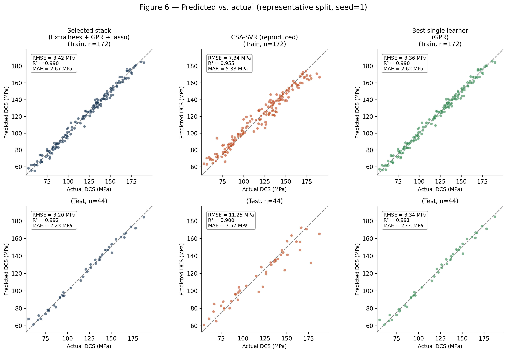
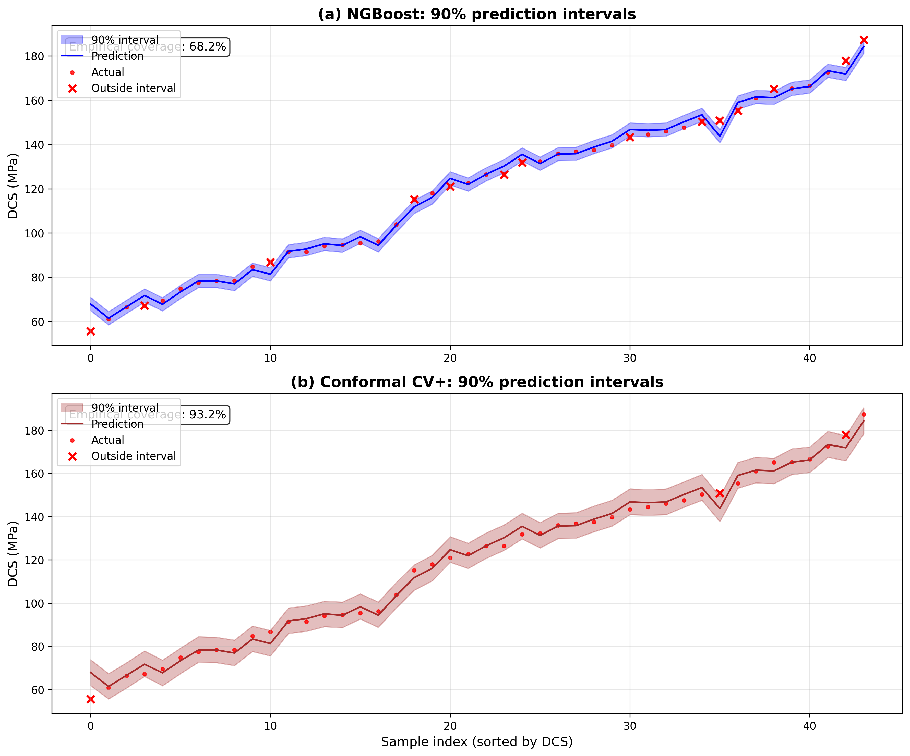

# Freeze-thaw sandstone strength

Predicts the dynamic compressive strength (DCS) of sandstone under impact after repeated freeze-thaw cycles, and attaches a calibrated uncertainty interval to every prediction. Built as a reproducible research pipeline with a fixed evaluation protocol.

## Data

216 split-Hopkinson pressure bar specimens from Meng et al. (2023): 6 freeze-thaw levels (0 to 100 cycles) x 4 confining pressures x 3 impact pressures, three replicates each. Five inputs (freeze-thaw cycles, confining pressure, impact pressure, porosity, characteristic impedance) and one target, DCS in MPa. The dataset belongs to the original authors and is not redistributed here.

## Method

1. **Fixed protocol, decided once.** 80 / 20 split stratified by DCS deciles, repeated over ten seeds; a second, harder split that holds out whole test conditions; scaling fitted on training data only; 5-fold cross-validation inside the training split for all tuning; the same evaluation budget for every optimiser. A guard object blocks access to the test set until the final evaluation, and every experiment is appended to one results ledger.
2. **Baselines reproduced.** Linear regression, the published CSA-tuned SVR, and default and Bayesian-tuned XGBoost.
3. **Learner pool.** Ten base learners tuned individually with Optuna, with out-of-fold predictions stored for stacking.
4. **Stacking architecture search.** All 4,052 combinations of base learners and meta-learner are enumerated as ground truth, and three metaheuristics (genetic algorithm, artificial bee colony, binary crow search) are checked against it.
5. **Uncertainty.** NGBoost, quantile LightGBM, Gaussian process, MC dropout and a deep ensemble are compared, and a cross-conformal wrapper is placed on the point model.
6. **Significance and interpretation.** Wilcoxon tests with Holm correction on per-split error, SHAP and partial dependence, and design charts with 5% fractile strengths for cold-region use.

## Results

Representative split (seed 1), test set:

| Model | RMSE (MPa) | MAE (MPa) | R² |
| --- | --- | --- | --- |
| **Selected stack** | 3.20 | 2.23 | **0.992** |
| Best single learner (Gaussian process) | 3.34 | 2.44 | 0.991 |
| CSA-SVR, reproduced baseline | 11.25 | 7.57 | 0.900 |

Mean over the ten locked splits:

| Model | RMSE (MPa) | R² |
| --- | --- | --- |
| Selected stack | 3.32 ± 0.21 | 0.991 ± 0.001 |
| XGBoost, default | 4.18 ± 0.57 | 0.986 ± 0.004 |
| Linear regression | 8.96 ± 0.65 | 0.934 ± 0.009 |

Uncertainty, mean over the ten splits:

| Method | Coverage at 90% | Coverage at 95% | Mean interval width at 90% (MPa) |
| --- | --- | --- | --- |
| **Conformal on the stack** | 90.2% | 95.2% | 10.9 |
| Quantile LightGBM | 91.4% | 95.2% | 19.2 |
| Gaussian process | 89.8% | 94.8% | 56.8 |
| NGBoost | 73.9% | 79.3% | 8.3 |

What the numbers say, stated plainly:

- The stack is far ahead of the reproduced published baseline and of linear regression.
- The stack is **not** significantly better than the best single learner (Gaussian process) or than an unoptimised full stack. The paired tests show a negligible difference. The architecture search buys consistency, not accuracy.
- The conformal wrapper is the only method that is both well calibrated and narrow. NGBoost gives narrower intervals but under-covers.

## What is in this repository

| File | Purpose |
| --- | --- |
| `full_study.ipynb` | The complete study, phase by phase, with outputs. Two long tuning logs are truncated. |
| `pipeline.ipynb` | The same methodology as one clean, restartable notebook with `fast` and `full` modes |
| `figures/` | Predicted against actual, prediction intervals, Taylor diagram |

## Run it

1. Obtain the dataset from the source publication and save it as `FT_Sandstone_DCS_Dataset.xlsx` (or `ml_dataset_v1.csv`) next to `pipeline.ipynb`.
2. In the configuration cell, leave `MODE = "fast"` for a smoke test of a few minutes, or set `MODE = "full"` for the reported numbers (ten seeds, several hours).
3. Run all cells. Heavy stages are cached under `results_nb/`, so an interrupted run resumes where it stopped.

Main dependencies: scikit-learn, XGBoost, LightGBM, CatBoost, NGBoost, Optuna, SHAP, PyTorch, pandas, matplotlib.

## Limits

216 specimens of one sandstone from one laboratory programme. The models interpolate inside the tested ranges; they should not be used for other rock types or beyond 100 freeze-thaw cycles without new tests.

## Author

Muhammad Umer Khan, [Neurals Solutions](https://neuralssolutions.com)

## License

MIT for the code. See [LICENSE](LICENSE).
